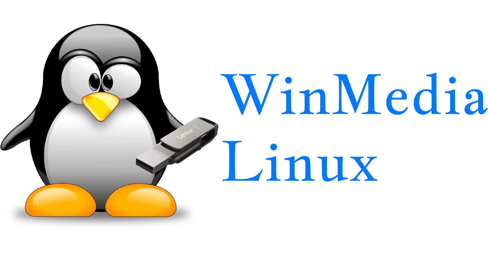

# WinMedia Linux

[](LICENSE)
[](pyproject.toml)
[](#requirements)
[-41CD52?logo=qt&logoColor=white)](https://doc.qt.io/qtforpython-6/)
[](https://github.com/ceuw/WinMedia-Linux/releases/tag/v0.1.0)
[](#project-status)

**WinMedia Linux** is a Linux-native desktop application for working with Windows installation media workflows, inspired by Microsoft’s Windows Media Creation Tool. It is built with **Python 3.11+** and **PySide6 (Qt)**.

> [!IMPORTANT]
> **Safety-gated foundation release.** This project prioritizes user data safety. Destructive USB operations (partitioning, formatting, writing, boot setup) are **not enabled** in the current build. The application does **not** format or overwrite devices automatically, does **not** claim bootability without appropriate verification, and must be validated on **real Linux hardware with disposable media** before any future destructive execution is enabled.

## Project status

| Area | Status | Notes |
|---|---|---|
| GUI foundation | Implemented | PySide6 app shell, sidebar navigation, dark/light themes, structured logging, dependency checks. |
| USB device detection | Implemented (read-only) | Linux `lsblk --json --bytes` inspection with safety flags and review-only selection. Removable/USB hints use sysfs/transport properties — **never inferred from `/dev/sdX` names alone**. |
| ISO management | Implemented (policy-constrained) | Local ISO selection/inspection, streaming SHA-256 verification, resumable HTTP(S) download engine/UI. **Automatic official Microsoft endpoint resolution is not fully automated.** |
| Bootable USB creation | Planning/guarded only | Validation, device identity checks, mount/system-disk/read-only guards, WIM/FAT32/boot planning notes, explicit typed-path confirmation, and **fail-closed** guarded execution. **No real disk writes in this build.** |
| Packaging / distribution | Baseline | Development workflow documented; packaging optimization can be expanded. |

## Key capabilities

- **Read-only device awareness:** surfaces model, path, capacity, filesystem/mount context, and safety flags without modifying disks.
- **Local ISO verification:** computes SHA-256 with progress and supports optional user-provided checksum comparison.
  - A matching hash helps detect corruption/mismatch against a value you trust, but a local hash alone does **not** prove an image is an official Microsoft ISO.
- **Resumable downloads (advanced):** HTTP(S) downloads with `.part` resume support (when the server supports ranges), progress/speed/ETA, and cancellation.
  - Users are responsible for ensuring any provided URL is an **official Microsoft source**. The project does **not** silently substitute third-party ISOs.
- **Safety-first USB planning:** previews a plan and requires explicit confirmation before any future execution path; execution remains fail-closed in this build.

## Safety principles

This repository follows the development/safety contract in [`AGENTS.md`](AGENTS.md):

- Never format or overwrite a device automatically.
- Never perform destructive operations without explicit user confirmation and device revalidation.
- Reject system disks and critical mount targets by design.
- Use argument-array process execution (no unsanitized shell command construction).
- Do not require root privileges for normal application startup.
- Use official Microsoft sources only for Windows downloads; do not hardcode temporary/unauthorized URLs or use third-party ISOs.
- Do not claim USB bootability without appropriate verification.

## Requirements

- **Python:** 3.11+
- **GUI framework:** [PySide6](https://doc.qt.io/qtforpython-6/)
- **Target platform:** Linux (X11/Wayland). The UI may run on other platforms for development/testing, but Linux system tools and device behavior are required for device-related functionality.

### Linux system tools

The **Settings → Dependency check** page reports availability of common tools used for Linux integration (current and planned), such as:

`lsblk`, `udisksctl`/UDisks2, `parted`, `blkid`, `mount`/`umount`, `wimlib-imagex` (wimtools)

Install missing tools using your distribution’s package manager.

## Installation (development)

```bash
# Clone the repository
git clone https://github.com/ceuw/WinMedia-Linux.git
cd WinMedia-Linux

# Create and activate a virtual environment
python -m venv .venv

# Linux/macOS
source .venv/bin/activate

# Windows PowerShell (development/testing)
# .\.venv\Scripts\Activate.ps1

# Install dependencies
python -m pip install --upgrade pip
python -m pip install -r requirements.txt

# Optional: editable install with dev/test tools
python -m pip install -e ".[dev]"
```

## Usage

```bash
# Run the application
python -m winmedia

# If installed as an editable/script entry point
winmedia

# UI smoke test (creates the UI and exits)
python -m winmedia --smoke-test

# Headless environments (where supported by Qt)
QT_QPA_PLATFORM=offscreen python -m winmedia --smoke-test
```

## Testing

```bash
python -m pytest -q
```

GUI smoke tests use `pytest-qt` (offscreen where supported).

## Repository layout

```text
.
├── AGENTS.md                 # Development/safety contract
├── README.md
├── LICENSE                   # MIT
├── pyproject.toml
├── requirements.txt
├── docs/
│   ├── architecture.md
│   ├── installation.md
│   └── troubleshooting.md
├── src/winmedia/
│   ├── gui/                  # PySide6 UI
│   ├── core/                 # ISO/download/verification and USB planning/guards
│   ├── services/             # Dependency checks, read-only detection, privilege stubs
│   └── utils/                # Logging, paths, validators
└── tests/
```

## Documentation

- [`AGENTS.md`](AGENTS.md) — project contract, safety rules, and workflow
- [`docs/architecture.md`](docs/architecture.md) — module boundaries and safety notes
- [`docs/installation.md`](docs/installation.md) — installation guidance
- [`docs/troubleshooting.md`](docs/troubleshooting.md) — common issues
- [`HANDOFF.md`](HANDOFF.md) — maintainer/session handoff notes
- [`LOG.md`](LOG.md) — development progress and limitations

## Known limitations

- **Official Microsoft download automation:** not fully automated. The project must not hardcode expiring/unauthorized URLs or use third-party ISOs.
- **Destructive USB execution:** fail-closed/safety-gated in this build. Real hardware behavior and bootability require validation on Linux with disposable media.
- **Bootability:** not claimed without appropriate verification.
- **Development environment variance:** Linux device/runtime behavior should be validated on supported Linux systems.

## Contributing

Contributions should follow [`AGENTS.md`](AGENTS.md): prioritize data safety, keep changes maintainable, add/update tests, and document behavior and limitations clearly. Do not introduce automatic destructive disk operations or unverified bootability claims.

## License

Licensed under the **MIT License**. See [`LICENSE`](LICENSE).

## Disclaimer

WinMedia Linux is an independent project and is **not affiliated with or endorsed by Microsoft**. Windows is a trademark of Microsoft Corporation. Users are responsible for complying with applicable licenses and terms when obtaining and using Windows installation media.
